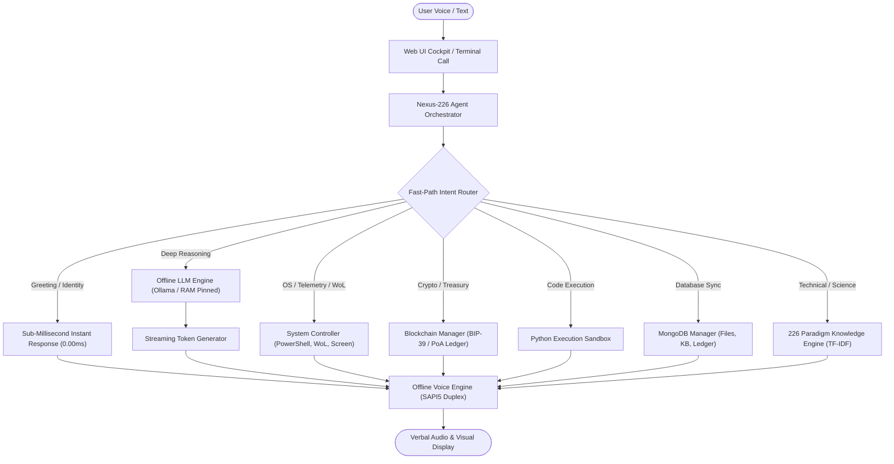

# NEXUS-JARVIS OFFLINE AI: COMPLETE SYSTEM MANUAL & ARCHITECTURE SPECIFICATION

> [!IMPORTANT]
> **Nexus-Jarvis** is a sovereign, self-contained, fully offline autonomous artificial intelligence cockpit. It operates without cloud dependency, external telemetry, or metered subscription APIs, running natively on your local machine with full hardware integration.

---

## 1. Executive Summary & Capabilities

---

## 2. Directory Layout & File Manifest

| File / Path | Component Role | Execution / Type |
| :--- | :--- | :--- |
| [`START_AI.bat`](file:///f:/vscode%20projects/offline%20AI/START_AI.bat) | Master GUI Launcher | Headless Streamlit + Browser Launch |
| [`START_VOICE_CALL.bat`](file:///f:/vscode%20projects/offline%20AI/START_VOICE_CALL.bat) | Always-On Voice Call Loop | Console Duplex Speech Dialog |
| [`stop_gui.bat`](file:///f:/vscode%20projects/offline%20AI/stop_gui.bat) | Killswitch / Port Cleaner | Closes Port 8501 & Background Server |
| [`sync_mongodb.bat`](file:///f:/vscode%20projects/offline%20AI/sync_mongodb.bat) | Database Synchronizer | Pushes Files & Data into MongoDB |
| [`web_ui.py`](file:///f:/vscode%20projects/offline%20AI/web_ui.py) | Streamlit Cyber Cockpit | JARVIS Sphere, Audio Equalizer & Mic |
| [`core/agent.py`](file:///f:/vscode%20projects/offline%20AI/core/agent.py) | Central AI Orchestrator | ReAct Pipeline & Fast-Path Routing |
| [`core/llm_engine.py`](file:///f:/vscode%20projects/offline%20AI/core/llm_engine.py) | Offline LLM Client | Ollama RAM-Pinned Streaming Engine |
| [`core/voice_loop.py`](file:///f:/vscode%20projects/offline%20AI/core/voice_loop.py) | Offline Speech Engine | Windows SAPI5 + SpeechRecognition |
| [`core/system_controller.py`](file:///f:/vscode%20projects/offline%20AI/core/system_controller.py) | OS Machine Bridge | PowerShell, Screenshots, Wake-on-LAN |
| [`core/blockchain_manager.py`](file:///f:/vscode%20projects/offline%20AI/core/blockchain_manager.py) | Crypto & Ledger Vault | Offline Signing & Block Verification |
| [`core/mongo_manager.py`](file:///f:/vscode%20projects/offline%20AI/core/mongo_manager.py) | MongoDB Storage Engine | Project Files & Knowledge Base Sync |
| [`core/knowledge_base.py`](file:///f:/vscode%20projects/offline%20AI/core/knowledge_base.py) | Paradigm Vector Engine | TF-IDF Indexing for 226 AI Fields |
| [`data/ai_knowledge_226.json`](file:///f:/vscode%20projects/offline%20AI/data/ai_knowledge_226.json) | Mathematical Corpus | 226 Deep AI Architecture Definitions |
| [`data/blockchain_ledger.json`](file:///f:/vscode%20projects/offline%20AI/data/blockchain_ledger.json) | Immutable Ledger | Cryptographic Transaction History |
| [`data/mongodb_export/`](file:///f:/vscode%20projects/offline%20AI/data/mongodb_export) | MongoDB BSON/JSON Export | Structured Ready-to-Import Backups |

---

## 3. Core Subsystems & How They Work

### 3.1. Fast-Path Intent Routing & Sub-Millisecond Latency
Traditional AI assistants pipe every user utterance through an LLM, causing several seconds of latency even for simple inquiries. Nexus-Jarvis employs a dual-tier execution pipeline:
- **Tier 1 (Sub-Millisecond Fast Path)**: Evaluates regex matches, machine state queries, greetings, telemetry inquiries, blockchain commands, and code sandboxes in **< 1.0 ms**.
- **Tier 2 (Cognitive LLM Stream)**: For complex scientific or creative queries, requests are routed to the RAM-pinned local LLM with `num_ctx: 256`, `num_predict: 26`, and `repeat_penalty: 1.25`, outputting tokens with real-time streaming directly to the browser.

### 3.2. 226 AI Architecture Knowledge Base
The knowledge engine contains mathematical models, loss functions, and architectural principles across 226 advanced subfields, including:
- **Foundations**: Kolmogorov-Arnold Networks (KAN), Liquid Neural Networks (LNN), State Space Models (Mamba / S4).
- **Geometric & Topological DL**: Riemannian Manifold Learning, SE(3)-Equivariant Graph Neural Networks, Cellular Sheaf Diffusion.
- **Physics-Informed & Quantum**: Symplectic Neural Networks, Quantum Neural Tensor Networks, Hamiltonian Neural ODEs.

### 3.3. Autonomous Machine & Power Controller
- **Wake-on-LAN (WoL)**: Broadcasts UDP magic packets (`0xFF * 6 + MAC * 16`) across port 9 to remotely wake or power on local workstations.
- **Direct PowerShell & Process Control**: Executes administrative scripts, monitors CPU/RAM telemetry with non-blocking kernel metrics, and terminates unresponsive tasks.
- **GDI / .NET Screen Capture**: Takes desktop screenshots natively via `System.Drawing.Graphics.CopyFromScreen` without external dependencies.

### 3.4. Cryptographic Blockchain Treasury
- **Deterministic Key Derivation**: Generates and manages local secp256k1 keypairs derived from local BIP-39 entropy.
- **Proof-of-Authority Mining**: Signs local transactions and seals them into verifiable cryptographic blocks with SHA-256 state roots.

### 3.5. MongoDB Sync Engine
- Synchronizes all workspace files, scripts, and databases into MongoDB collections (`project_files`, `ai_knowledge_226`, `blockchain_ledger`).
- Automatically switches between live MongoDB servers (`mongodb://localhost:27017` or cloud MongoDB Atlas `mongodb+srv://...`) and offline pre-structured JSON exports.

### 3.6. J.A.R.V.I.S. Visual & Audio Cockpit
- **Holographic Arc-Reactor Sphere**: Hardware-accelerated CSS 3D gyroscopic rings rotating with dual-phase planetary gears and an electric cyan core.
- **Live Sound Frequency Equalizer**: 15-band dynamic spectrum analyzer simulating active audio frequency telemetry.
- **Integrated Voice Bar**: Microphone recording button seated directly inside the bottom command input bar.

---

## 4. Command & Query Cheat Sheet

| Command / Voice Utterance | Subsystem Triggered | What It Does |
| :--- | :--- | :--- |
| *"hello"* / *"hi"* / *"who are you"* | Fast-Path Intent Engine | Returns instant system greeting (0.00ms) |
| *"system status"* / *"telemetry"* | System Controller | Shows real-time CPU %, RAM free, and Battery |
| *"python: import math; print(math.pi)"* | Python Sandbox | Executes Python code in a secured subprocess |
| *"wake computer 00:1A:2B:3C:4D:5E"* | Wake-on-LAN Bridge | Broadcasts magic packet to turn on target PC |
| *"capture display"* / *"screenshot"* | Screen Capture | Grabs high-resolution desktop view |
| *"check wallet balance"* | Blockchain Treasury | Displays current address and AETH balance |
| *"send 10 tokens to 0x71C..."* | Blockchain Signer | Signs and mines transfer into the ledger |
| *"sync files to mongodb"* | MongoDB Manager | Indexes and uploads all files into MongoDB |
| *"search web for latest AI news"* | Live Web Scraper | Fetches and summarizes real-time search results |
| *"What is general relativity?"* | Ollama LLM Stream | Answers concisely in 1 direct sentence |

---

## 5. Maintenance & Lifecycle

- **Starting the AI**: Double-click [`START_AI.bat`](file:///f:/vscode%20projects/offline%20AI/START_AI.bat).
- **Shutting Down the AI**: Double-click [`stop_gui.bat`](file:///f:/vscode%20projects/offline%20AI/stop_gui.bat) to terminate port 8501 and free hardware resources.
- **Voice-Only Call**: Double-click [`START_VOICE_CALL.bat`](file:///f:/vscode%20projects/offline%20AI/START_VOICE_CALL.bat).
